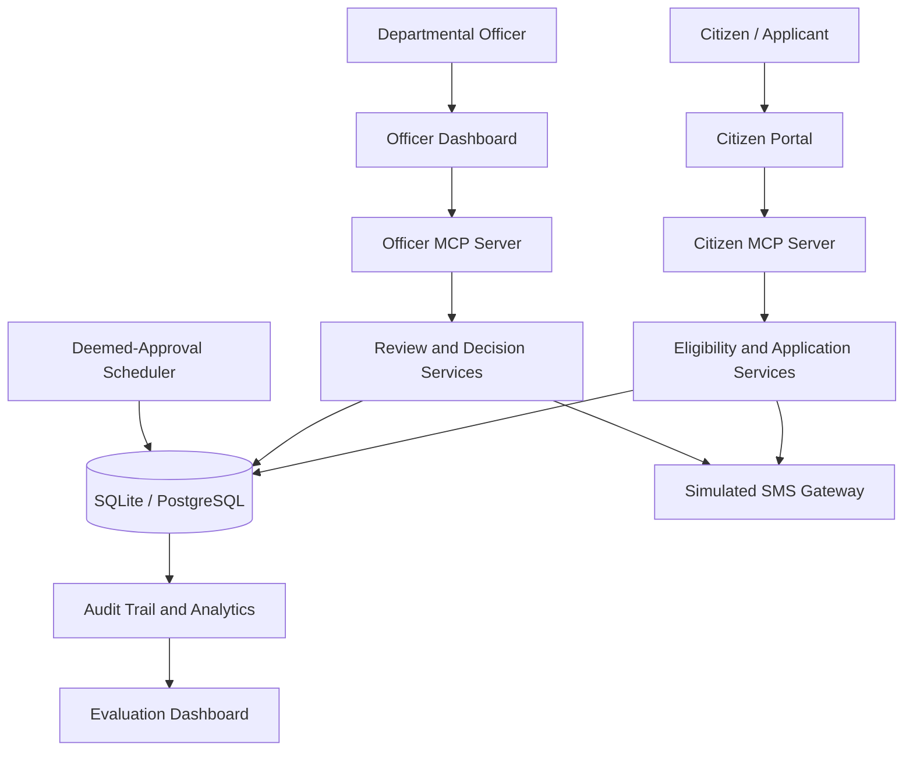

# 🏛️ Sewa Setu — Old Age Pension Portal & Agentic MCP Platform

### Re-imagining Public Welfare for an Agentic World

**Build for Bharat Fellowship | AI Track**

Sewa Setu is an AI-ready public welfare platform designed to simplify old-age pension services through conversational AI agents, secure Model Context Protocol (MCP) integration, automated eligibility validation, application tracking, and transparent decision-making.

Developed for the **Department of Social Welfare, Government of Purvanchal** as a fellowship challenge project, the platform demonstrates how agentic AI can make public services more accessible, secure, and accountable.

---

## 📌 Table of Contents

- [Overview](#-overview)
- [Key Features](#-key-features)
- [System Architecture](#-system-architecture)
- [Technology Stack](#-technology-stack)
- [Quick Start](#-quick-start)
- [Application Portals](#-application-portals)
- [MCP Servers and Tools](#-mcp-servers-and-tools)
- [Security and Governance](#-security-and-governance)
- [Evaluation and Benchmarking](#-evaluation-and-benchmarking)
- [Project Structure](#-project-structure)
- [Demo Credentials](#-demo-credentials)
- [Future Enhancements](#-future-enhancements)

---

## 🌟 Overview

Traditional public welfare systems can create barriers for elderly citizens due to complex application procedures, limited access to information, and difficulty tracking application progress.

**Sewa Setu addresses these challenges through an agent-ready pension service platform** that separates citizen-facing operations from departmental officer operations using two independent MCP servers.

The platform supports the complete application lifecycle:

1. Check eligibility for an old-age pension.
2. Understand scheme guidelines and documentation requirements.
3. Submit a pension application through a conversational assistant.
4. Receive an application acknowledgment and SMS notification.
5. Track application status and statutory service timelines.
6. Allow authorized officers to review, approve, or reject applications.
7. Monitor pending applications and service-level agreement (SLA) breaches.
8. Automatically process eligible overdue applications through a deemed-approval scheduler.

### Core Objectives

- Make pension services easier to access for elderly citizens.
- Enable conversational interaction through AI agents.
- Enforce eligibility and application rules at the system level.
- Protect sensitive citizen information through role separation.
- Improve transparency through audit trails and status tracking.
- Evaluate agent behavior using realistic personas and database assertions.

---

## ✨ Key Features

### 👵 1. Citizen-Centric Pension Services

- Age-based eligibility verification (minimum age: 60 years).
- Scheme guidelines and document requirement assistance.
- Conversational pension application submission.
- Application status tracking with SLA information.
- Safe withdrawal of pending applications for corrections.
- PDF acknowledgment generation.
- Block-level helpdesk and Seva Kendra information.
- Simulated SMS notifications for application events.

### 🤖 2. Agentic AI Integration with MCP

- Two independent MCP server endpoints for citizens and officers.
- Streamable HTTP transport and Server-Sent Events (SSE) support.
- Structured tools for eligibility checks, applications, status inquiries, and officer workflows.
- Separation of citizen and officer tool capabilities.
- Interactive playground for testing agent conversations and tool calls.

### 🏢 3. Departmental Officer Dashboard

- Application queue management.
- Filtering by application status and administrative block.
- Identification of applications exceeding the 15-day SLA.
- Detailed application dossier and audit-trail inspection.
- Automated eligibility and banking-format compliance checks.
- Application approval and rejection with recorded reasons.
- Dashboard analytics for application volumes, decisions, and overdue cases.

### ⏱️ 4. Automated Deemed-Approval Workflow

- Background scheduler for overdue applications.
- Processing of eligible applications pending beyond the configured 15-day period.
- Recorded decision timestamps and decision-maker information.
- Audit logging for accountability.

### 📊 5. Evaluation and Benchmarking

- Seven realistic citizen and officer personas.
- Automated workflow testing.
- Database-level assertions after agent interactions.
- Underage applicant and duplicate-application boundary tests.
- Application withdrawal and resubmission scenarios.
- Live interactive playground with tool-call inspection.

### 📱 6. Simulated Telecom SMS Gateway

- Embedded or standalone gateway support.
- Simulated SMS delivery for application events.
- Web-based gateway console.
- JSON endpoint for inspecting simulated messages.

### 🗄️ 7. Flexible Database Support

- SQLite for convenient local execution.
- PostgreSQL support through the database adapter.
- Seeded application dataset containing 100,000 records.
- Structured application, user, decision, and audit data.

---

## 🏗️ System Architecture

Sewa Setu follows a role-separated architecture that places access boundaries at the application and tool layers rather than relying solely on AI model instructions.



### Architectural Principles

- **Role separation:** Citizen-facing agents receive citizen tools; officer tools are exposed through a separate endpoint.
- **Rule-based validation:** Eligibility and application constraints are validated by backend services.
- **Traceability:** Application actions are recorded in an audit trail.
- **Interoperability:** MCP provides a structured interface for compatible AI clients.
- **Testability:** Evaluation workflows verify resulting database states, not merely generated responses.

---

## 🛠️ Technology Stack

| Component | Technology |
|---|---|
| Backend application | Python, Flask |
| Agent integration | Model Context Protocol (MCP) |
| MCP transports | Streamable HTTP, SSE |
| Authentication and authorization | OAuth 2.1 components, JWT/JWKS support |
| Database | SQLite / PostgreSQL |
| SMS simulation | Custom telecom gateway |
| Document generation | PDF acknowledgment generation |
| Background processing | Deemed-approval scheduler |
| Evaluation | Persona-based benchmark suite and SQL assertions |
| Deployment | Local Python runner, Docker, Docker Compose |

---

## 🚀 Quick Start

### Prerequisites

For local execution, install:

- Python 3.10 or a compatible version required by the project dependencies.
- Git.
- A terminal such as Windows PowerShell, Command Prompt, or a Linux/macOS shell.

For containerized execution, install Docker and Docker Compose.

### 1. Clone the Repository

```bash
git clone <YOUR_GITHUB_REPOSITORY_URL>
cd <YOUR_REPOSITORY_FOLDER>
```

Replace the placeholders with your actual GitHub repository URL and folder name.

### 2. Start the Local Application

```bash
python run_local.py
```

The local runner is designed to initialize the application database, start the deemed-approval scheduler, launch the simulated SMS gateway, and serve the portal and MCP endpoints on port `8000`.

### 3. Open the Application

Visit the following URL in your browser:

**Portal:** http://localhost:8000

**Evaluation Dashboard:** http://localhost:8000/eval-dashboard

> **Note:** The local runner is intended to provide a convenient development and demonstration environment. Verify that the initialization process has completed before using the application.

### Alternative: Docker Compose

For containerized execution:

```bash
ADMIN_PASSWORD=admin123 docker compose up --build
```

On Windows PowerShell:

```powershell
$env:ADMIN_PASSWORD="admin123"
docker compose up --build
```

Use a strong, unique password for any deployment beyond a local demonstration. Configure production secrets through a secure environment or secrets manager rather than committing them to the repository.

---

## 🌐 Application Portals and Endpoints

With the application running locally on port `8000`, the following endpoints are intended to be available.

### User Interfaces

| Service | URL | Purpose |
|---|---|---|
| Portal Home | http://localhost:8000 | Main application portal |
| Evaluation Dashboard | http://localhost:8000/eval-dashboard | Benchmark results and interactive evaluation |
| Citizen Status Portal | http://localhost:8000/status | Citizen application status tracking |
| Officer Login | http://localhost:8000/admin | Departmental officer interface |
| SMS Gateway Console | http://localhost:8000/__gateway/ | Simulated SMS inspection |

### MCP and Authentication Endpoints

| Endpoint | Purpose |
|---|---|
| `/mcp/citizen` | Citizen MCP server using Streamable HTTP |
| `/mcp/citizen/sse` | Citizen MCP SSE endpoint |
| `/mcp/officer` | Officer MCP server using Streamable HTTP |
| `/mcp/officer/sse` | Officer MCP SSE endpoint |
| `/.well-known/oauth-authorization-server` | OAuth authorization server metadata |
| `/.well-known/jwks.json` | Public JSON Web Key Set endpoint |
| `/__gateway/api/messages?to=<mobile>` | Inspect simulated SMS messages for a mobile number |

These are local development URLs, not public internet addresses. Endpoint availability depends on the configured application routes and transport implementation.

---

## 🔌 MCP Servers and Available Tools

Sewa Setu implements two separate MCP interfaces to distinguish citizen operations from departmental workflows.

### 1. Citizen MCP Server

**Endpoint:** `/mcp/citizen`

Designed for citizens and citizen-facing AI assistants.

| Tool | Description |
|---|---|
| `check_eligibility` | Checks age, administrative block, scheme deadline, and duplicate active applications. |
| `get_scheme_guidelines` | Returns pension amount, accepted age proofs, and service timeline information. |
| `submit_application` | Validates and records an application, provisions status access, creates an audit entry, and triggers an SMS receipt. |
| `check_application_status` | Retrieves application status and explains progress against the configured SLA. |
| `withdraw_application` | Withdraws an eligible pending application so the applicant can correct information and reapply. |
| `download_acknowledgment` | Provides access to the generated application acknowledgment PDF. |
| `find_nearest_helpdesk` | Returns relevant BDO and Seva Kendra contact information for the applicant's block. |

### 2. Officer MCP Server

**Endpoint:** `/mcp/officer`

Designed for authorized departmental officers and queue-management assistants.

| Tool | Description |
|---|---|
| `list_applications` | Filters the application queue by status, block, and overdue SLA. |
| `get_application_details` | Retrieves application details and the associated audit history. |
| `review_application_eligibility` | Checks eligibility and banking-field formats against configured validation rules. |
| `approve_application` | Approves an eligible pending application, records decision metadata, and triggers an SMS. |
| `reject_application` | Rejects a pending application with a mandatory plain-language justification and audit record. |
| `get_dashboard_analytics` | Provides application totals, status distribution, overdue cases, and approval metrics. |
| `trigger_sla_deemed_approvals` | Invokes the configured deemed-approval workflow for eligible overdue applications. |

### Why Two MCP Servers?

Separating the interfaces reduces the tools available to each class of agent. A citizen-facing agent should not receive officer-only tools through its MCP interface.

However, separate endpoints alone are not a complete security boundary. Production deployments must also enforce authentication, authorization, ownership checks, and server-side permission validation for every sensitive operation.

---

## 🔐 Security and Governance

Security is especially important when AI agents interact with public welfare records.

Sewa Setu incorporates or is designed around the following controls:

- **Role-separated interfaces:** Distinct citizen and officer MCP endpoints.
- **Server-side validation:** Eligibility and application constraints enforced by backend logic.
- **Audit trails:** Application submission, withdrawal, approval, and rejection events recorded for traceability.
- **Authentication support:** OAuth authorization metadata and JWKS endpoints.
- **Structured tools:** Defined tool operations instead of unrestricted database access.
- **Boundary testing:** Scenarios for underage applicants, duplicate submissions, and incorrect banking details.
- **Privacy awareness:** Citizen information and banking data should only be exposed to authorized users and operations.

> **Important:** This project is a demonstration platform. Before real-world public deployment, independently verify authentication enforcement, token validation, transport security, document access controls, data retention, privacy compliance, rate limiting, and protection against prompt injection. Do not use sample credentials or synthetic datasets for production services.

---

## 🧪 Evaluation and Benchmarking

The `/eval-dashboard` provides a structured environment for evaluating conversational workflows and backend correctness.

### Seven Evaluation Personas

| Persona | Scenario | Expected Behavior |
|---|---|---|
| Bhabesh Kalita, 68 | Rural applicant from Namti | Complete a valid application workflow. |
| Shanti Devi, 62 | Elderly widow from Sonari | Explain documentation requirements and support application submission. |
| Tarun Gogoi, 57 | Underage applicant from Rajapara | Decline the ineligible application and explain the age requirement. |
| Rumi Barua, 71 | Applicant from Borgaon | Explain application status and the configured SLA timeline. |
| Nogen Bora, 65 | Applicant from Khelua | Support safe withdrawal and correction through resubmission. |
| Pratima Hazarika, 64 | Applicant from Dhemaji Pathar | Prevent duplicate active applications. |
| Officer Ramesh Sharma | Sonari Block Development Officer | Review the queue and process eligible applications. |

### Evaluation Methodology

The benchmark goes beyond evaluating conversational quality.

Each workflow can also check the resulting system state through database assertions, including:

- Whether a valid application was recorded.
- Whether an underage applicant was prevented from submitting an eligible application.
- Whether duplicate active applications were blocked.
- Whether a withdrawal was recorded correctly.
- Whether approval or rejection metadata was persisted.
- Whether audit events were created as expected.

### Live Evaluation Playground

Open:

http://localhost:8000/eval-dashboard

Use the interactive playground to test prompts against the configured MCP servers and inspect the associated tool interactions.

**Evaluation objective:** Assess both the correctness of agent decisions and the integrity of the underlying application state.

---

## 📂 Project Structure

```text
Sewa-Setu/
├── run_local.py
├── DESIGN_NOTE.md
├── LOOM_SCRIPT.md
├── BRIEF.md
├── README.md
├── docker-compose.yml
│
├── app/
│   ├── app.py
│   ├── db_adapter.py
│   ├── mcp_citizen.py
│   ├── mcp_officer.py
│   ├── eval_dashboard.py
│   ├── sms_gateway.py
│   ├── oauth.py
│   ├── schema.sql
│   │
│   └── scripts/
│       └── deemed_approval.py
│
├── seed/
│   └── seed.sql
│
└── smsgw/
    └── [SMS gateway service files]
```

*The structure above reflects the documented project layout. Additional configuration, dependency, template, test, and deployment files may exist in the repository.*

### Important Files

| File | Responsibility |
|---|---|
| `run_local.py` | Starts the local demonstration environment. |
| `app/app.py` | Core Flask application and routes. |
| `app/db_adapter.py` | Database access and SQLite/PostgreSQL support. |
| `app/mcp_citizen.py` | Citizen MCP interface. |
| `app/mcp_officer.py` | Officer MCP interface. |
| `app/eval_dashboard.py` | Evaluation personas, dashboard, and testing workflows. |
| `app/sms_gateway.py` | Simulated telecom messaging service. |
| `app/oauth.py` | OAuth-related authorization functionality. |
| `app/schema.sql` | Database schema. |
| `app/scripts/deemed_approval.py` | Deemed-approval scheduler logic. |
| `seed/seed.sql` | Seed dataset for application records. |
| `DESIGN_NOTE.md` | Architecture decisions and design rationale. |
| `LOOM_SCRIPT.md` | Script for the project presentation video. |
| `BRIEF.md` | Fellowship challenge brief and requirements. |

---

## 🔑 Demo Credentials

The documented local demonstration configuration uses the following credentials.

| Portal | Username | Password |
|---|---|---|
| Departmental Officer | `admin` | `admin123` |

### Citizen Status Portal

- Open: http://localhost:8000/status
- Enter the registered mobile number.
- Enter the applicant's date of birth in `DDMMYYYY` format if the local implementation uses the documented demo authentication flow.

Citizen credentials depend on the seeded or submitted application data.

**Security note:** These are demonstration defaults, not production credentials. Change the administrator password before deployment, avoid publishing real citizen details, and never commit actual passwords, API keys, or private credentials.

---

## 🌱 Social Impact and Expected Benefits

Sewa Setu explores how agentic AI can improve access to public welfare services by:

- Simplifying eligibility and application guidance.
- Reducing repeated visits for status inquiries.
- Making application decisions more traceable.
- Helping officers identify overdue cases.
- Supporting structured testing of citizen-facing AI workflows.
- Demonstrating how backend-enforced rules can constrain high-impact AI actions.

These are intended benefits; actual improvements in processing time, accessibility, or citizen satisfaction should be established through field testing and measured evaluation.

---

## 🚀 Future Enhancements

Potential future development directions include:

- Multilingual voice-based access for elderly citizens.
- Integration with verified government identity and service systems.
- Secure document upload and automated document validation.
- Expanded accessibility for low-bandwidth and mobile devices.
- Improved prompt-injection testing and adversarial evaluation.
- Independent security and privacy audits.
- Deployment monitoring, structured logs, and operational alerts.
- Performance testing with realistic workloads.
- Additional public-service workflows using reusable MCP interfaces.

---

## 🤝 Contributing

Contributions that improve accessibility, security, correctness, and maintainability are welcome.

1. Fork the repository.
2. Create a feature branch.
3. Implement and test your changes.
4. Submit a pull request describing the change and its validation.

Please avoid including real personal data, credentials, or production secrets in commits and test fixtures.

---

## 📜 Disclaimer

Sewa Setu is an AI-enabled public welfare demonstration project developed in the context of the Build for Bharat Fellowship AI Track.

The department name, pension rules, service timelines, and application data described here should be treated as project configuration or demonstration assumptions unless independently verified against applicable official government notifications.

The platform is not an official government service unless formally authorized and deployed by the relevant government department. Deemed approval must only be applied where legally authorized and in accordance with the applicable rules.

---

## 👨‍💻 Project Information

**Project:** Sewa Setu — Old Age Pension Portal & Agentic MCP Platform  
**Program:** Build for Bharat Fellowship — AI Track  
**Domain:** Agentic AI, GovTech, Public Welfare, MCP, Digital Governance

**Built to explore a simple idea: make public services more accessible to citizens while keeping AI actions secure, auditable, and accountable.**
